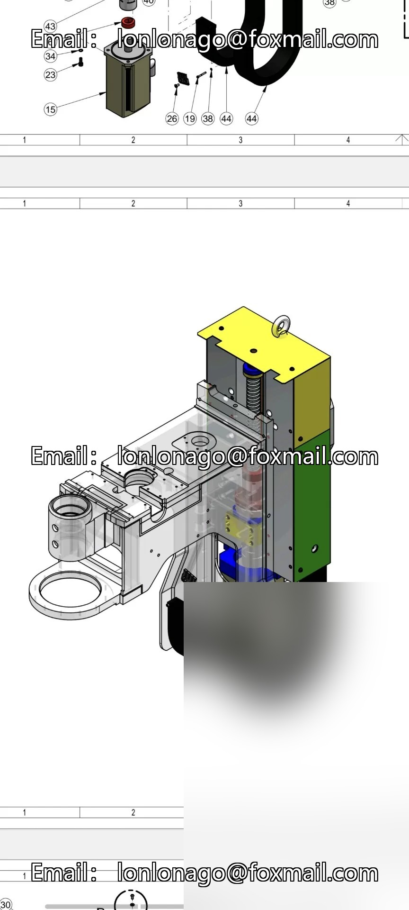
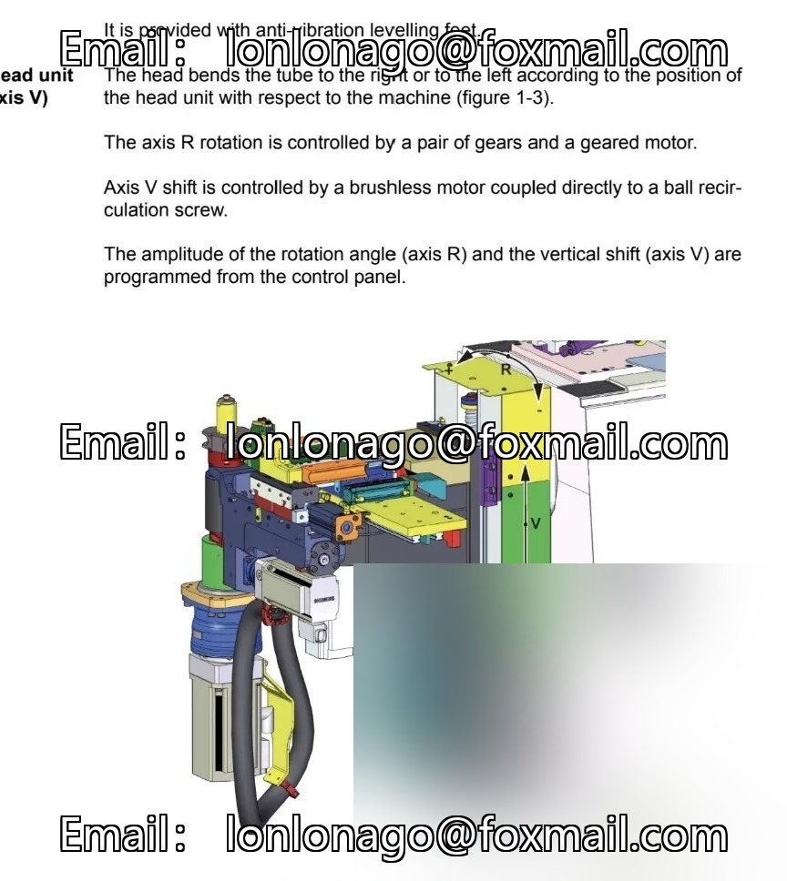
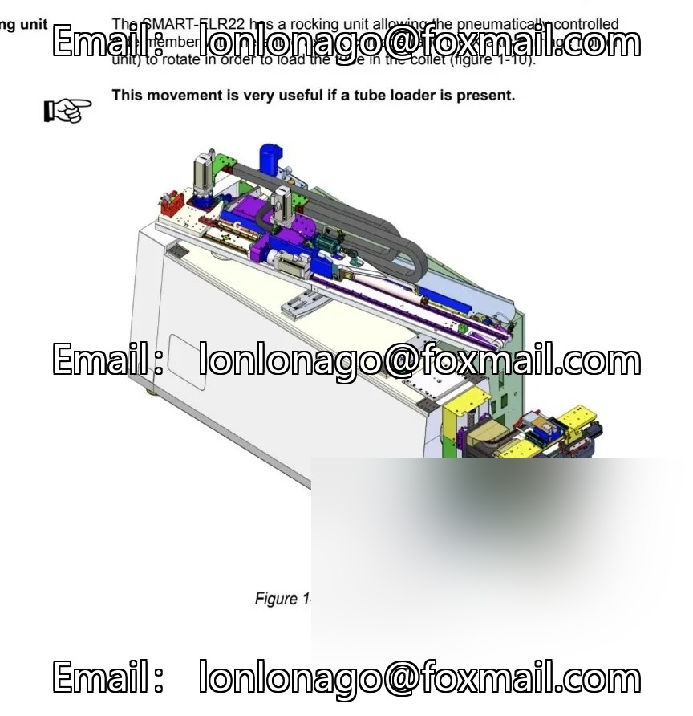
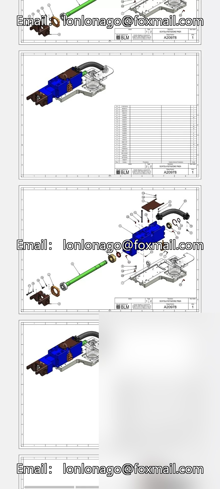
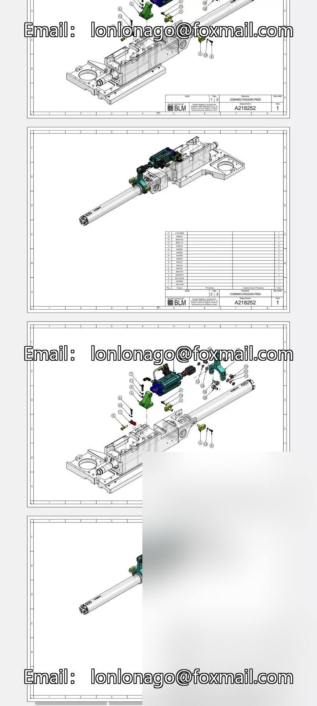
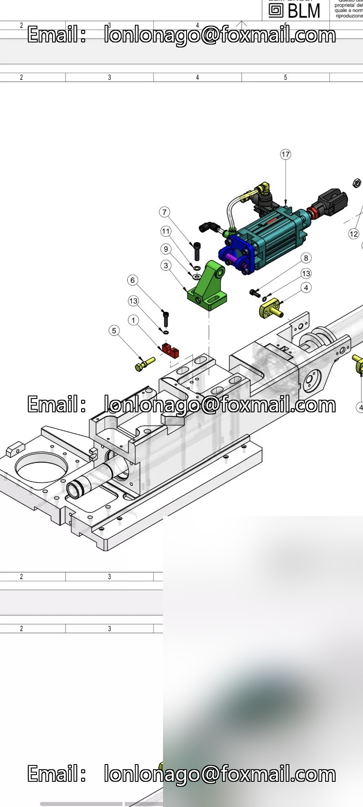

# Italy BLM GROUP's SMART ELR22

## Body

Italian BLM GROUP's SMART ELR22
Operation and Maintenance Manual
PDF electronic document version 440 pages
A high-end CNC pipe rolling machine equipped with all-electric drive and 8-axis control, mainly used for high-precision forming and processing of complex pipe parts.
78072
The following are the core technical characteristics of this device:

1. Device localization and core capabilities

All-electric 8-axis (All-electric 8-axis): Uses all servo motors to drive; compared with traditional hydraulic pipe bending machines, it has higher accuracy, faster response speed, better repeatability, and is more environmentally friendly and energy-saving.

Right and left process (bidirectional bending): supports forward and reverse bending, with extremely high flexibility, able to manufacture complex spatial three-dimensional tube parts.

Maximum machining pipe diameter: may be machined Fe/Ste (ferritic) tubes with maximum outer diameter of 28 mm, as well as stainless steel tubes with maximum diameter of 20 mm.

This is the Italian BLM GROUP SMART ELR22, a high-precision CNC tube bending machine with all-electric 8-axis control, mainly used for high-precision manufacturing of complex pipe parts, and it is provided with anti-vibration levelling feet.

<!-- AI_ENRICHED -->

## Images

## Payment

Here is a pay link on Stripe ( https://buy.stripe.com/3cs8yP7sY87d0vu9AB ). Please contact me lonlonago@foxmail.com after funding $89, and I will send you a complete data files , thank you!

